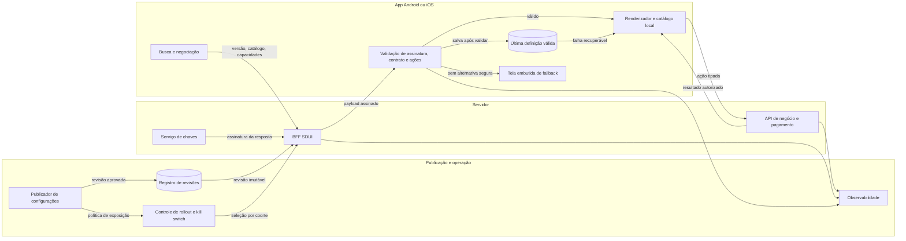

# Diagrama de componentes — SDUI

Setas indicam dependências lógicas, não protocolos específicos. O app não recebe a chave privada. A API de negócio autoriza a operação independentemente do resultado da validação local.
