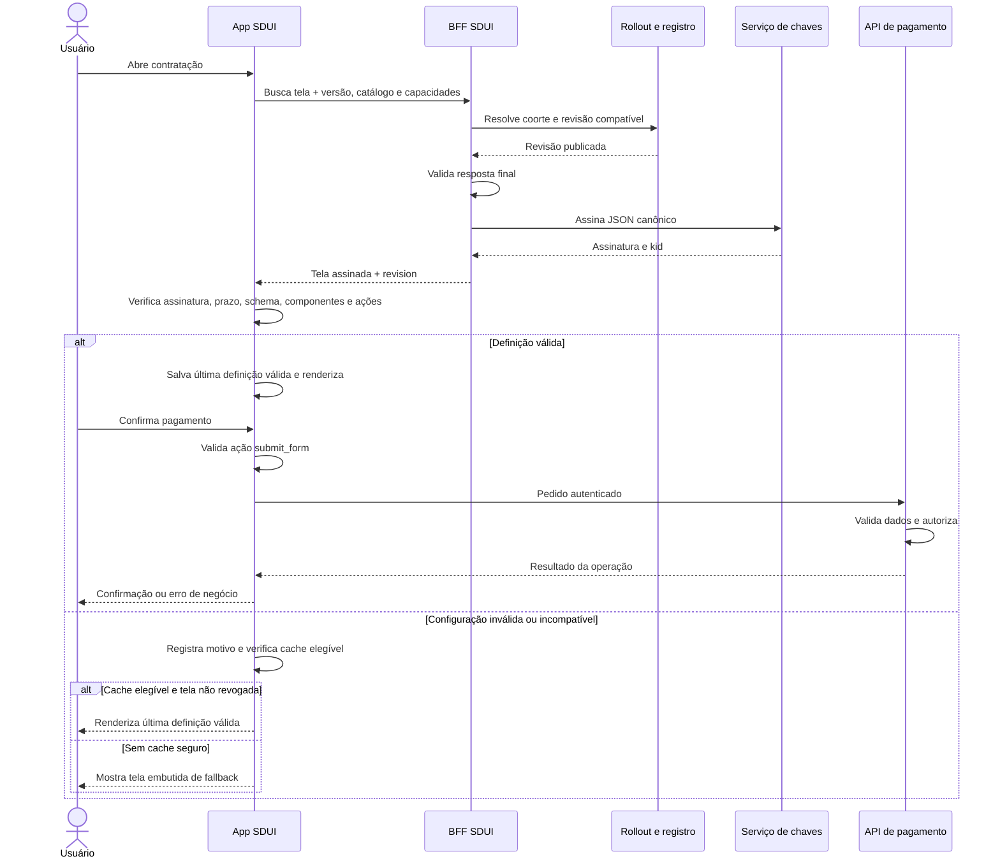

# Diagrama de sequência — jornada e exceção

Na tela crítica, a tentativa de usar cache exige consulta online da política de revogação. Se a consulta falhar, o app usa a tela embutida. O resultado de pagamento vem da API, nunca do payload SDUI.
