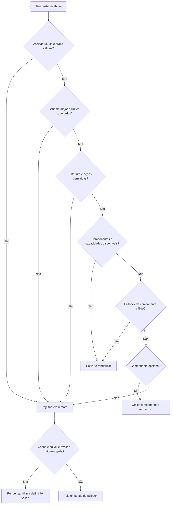

# Fluxo de validação no cliente

O validador percorre toda a árvore antes de renderizar. Um fallback de componente deve respeitar os mesmos limites, schema e allowlist; a omissão de componente não pode eliminar campo obrigatório da operação de pagamento.
